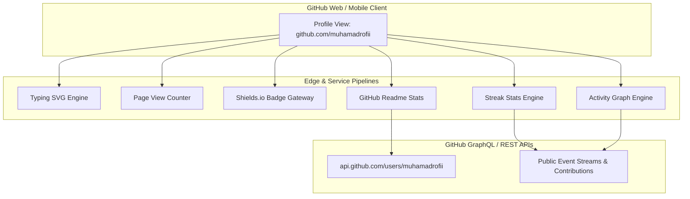

# Technical Specification: GitHub Profile Architecture

- **Project**: Developer Profile Landing Architecture
- **Repository**: `muhamadrofii/muhamadrofii`
- **Owner**: Muhamad Rofi'i (`muhamadrofii911@gmail.com`)
- **Role Positioning**: Software Engineer & Automation
- **Version**: 2.1.0
- **Status**: Production

---

## 1. System Objective & Scope

This specification defines the functional, structural, and integration requirements for the root GitHub Profile README (`muhamadrofii/muhamadrofii`). 

The profile positions the engineer as a **Software Engineer & Automation** specialist, emphasizing core strengths in:
1. Full-stack web and mobile engineering (Vue/Nuxt 3, Laravel, Django, Flutter).
2. End-to-end browser automation, scraping pipelines, and task orchestration (Python, Playwright).

The implementation enforces a minimalist engineering design: zero Unicode emojis, canonical Simple Icons, flat-square vector badges, and real-time statistical telemetry.

---

## 2. Architecture & Data Flow

---

## 3. Structural & Component Requirements

### 3.1 Hero Header & Identity
1. **Dynamic Vector Typewriter**:
   - Provider: `readme-typing-svg.demolab.com`
   - Parameters:
     - Font: `JetBrains Mono`
     - Font Weight: `500`
     - Font Size: `20px`
     - Color: `#38BDF8` (Cyan 400)
     - Lines:
       - `Software Engineer & Automation`
       - `Full-Stack Web, Mobile & Data Pipelines`
       - `Nuxt 3 • Laravel • Django • Flutter`
       - `Headless Browser Automation & Scraping`
2. **Telemetry Badges**:
   - Page view counter (`komarev.com/ghpvc/`, `color=0284c7`, `style=flat-square`).
   - Specialization tag (`Focus-Software_Engineer_%26_Automation`).
   - Availability and geographic metadata (`style=flat-square`).
3. **Direct Communication Protocol**:
   - Email: `mailto:muhamadrofii911@gmail.com` (Gmail badge)
   - LinkedIn: `https://linkedin.com/in/muhamadrofii` (LinkedIn badge)
   - GitHub: `https://github.com/muhamadrofii` (GitHub badge)

### 3.2 Technical Taxonomy (Shields.io + Simple Icons)

| Domain | Target Stack | Canonical Icon Key |
| :--- | :--- | :--- |
| **Languages** | JavaScript, TypeScript, Python, PHP, Dart, HTML5, CSS3, SQL | `javascript`, `typescript`, `python`, `php`, `dart`, `html5`, `css3`, `postgresql` |
| **Automation & Tools** | Playwright, Python Automation, Git, GitHub, Postman, Figma | `playwright`, `python`, `git`, `github`, `postman`, `figma` |
| **Backend & APIs** | Laravel, Django, Node.js, Express, Strapi | `laravel`, `django`, `nodedotjs`, `express`, `strapi` |
| **Frontend & Mobile** | Vue.js, Nuxt 3, Flutter, Tailwind CSS, Bootstrap | `vuedotjs`, `nuxtdotjs`, `flutter`, `tailwindcss`, `bootstrap` |
| **Storage & Databases** | MySQL, PostgreSQL, SQLite | `mysql`, `postgresql`, `sqlite` |

### 3.3 Dynamic Statistics Integration

| Service Component | Endpoint Pattern | Configuration Parameters |
| :--- | :--- | :--- |
| **Profile Stats** | `github-readme-stats.vercel.app/api` | `username=muhamadrofii&show_icons=true&theme=tokyonight&hide_border=false&count_private=true&include_all_commits=true` |
| **Top Languages** | `github-readme-stats.vercel.app/api/top-langs/` | `username=muhamadrofii&layout=compact&theme=tokyonight&hide_border=false` |
| **Streak Tracker** | `streak-stats.demolab.com/` | `user=muhamadrofii&theme=tokyonight&hide_border=false` |
| **Activity Graph** | `github-readme-activity-graph.vercel.app/graph` | `username=muhamadrofii&theme=tokyo-night&hide_border=false` |

### 3.4 Selected Repository Index

| Project Name | Architecture Pattern | Stack | Target Repository |
| :--- | :--- | :--- | :--- |
| **Data Scraping & Automation** | Headless Browser Automation & Pipelines | Python, Playwright | `scraping-google-play`, `scraping-X-2025` |
| **Bank Sampah Platform** | Mobile Client + REST API Backend | Flutter, Node.js, Express | `banksampah-flutter`, `backendBankSampah` |
| **Smart City Mobile** | Cross-Platform Mobile Client | Flutter, Dart, REST API | `smartcityflutteruas` |
| **Nuxt 3 Portfolio & CMS** | SSR / Headless CMS Integration | Nuxt 3, Vue 3, Strapi | `nuxtJs-3-personalPortofolio` |
| **SIMKODES** | Monolithic MVC Management | Laravel, Blade, MySQL | `simkodes` |

---

## 4. Performance & Availability Constraints

1. **Sub-second Asset Rendering**: Badges are served via global edge CDNs (Fastly/Cloudflare via Shields.io).
2. **Stateless Dynamic Metrics**: Statistics cards calculate metrics on request using GitHub's GraphQL API; cache TTL is enforced upstream (default 2 to 4 hours) to prevent GitHub secondary rate limiting.
3. **No External Script Dependencies**: All components are rendered via static HTML and SVG markup supported natively by GitHub Markdown sanitation rules.

---

## 5. Maintenance Runbook

- **Adding Tech Badges**: Append to `README.md` following `-<HEX>?style=flat-square&logo=<SLUG>&logoColor=white" />`.
- **Project Re-ordering**: Update the Markdown table under `### Selected Projects` with repository links and stack definitions.
- **Upstream Service Health**: If an external stats service experiences downtime, the corresponding image link can fail gracefully or be updated without layout disruption.
