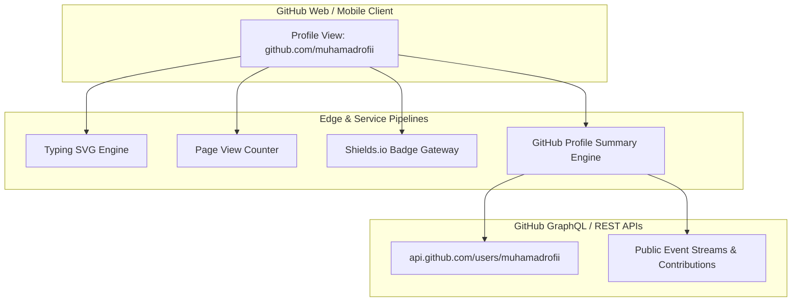

# Technical Specification: GitHub Profile Architecture

- **Project**: Developer Profile Landing Architecture
- **Repository**: `muhamadrofii/muhamadrofii`
- **Owner**: Muhamad Rofi'i (`muhamadrofii911@gmail.com`)
- **Role Positioning**: Software Engineer & Automation
- **Version**: 2.6.0
- **Status**: Production

---

## 1. System Objective & Scope

This specification defines the functional, structural, and integration requirements for the root GitHub Profile README (`muhamadrofii/muhamadrofii`). 

The architecture deploys an ultra-minimalist, high-signal developer portfolio:
1. **Zero Tacky Emojis**: Replaced with canonical Simple Icons and clean typographic hierarchy.
2. **Streamlined Single-Line Project Index**: Fast-scanning list entries keeping the README lightweight and uncluttered.
3. **Scaled Single-Card Telemetry**: High-density activity wave card scaled to 520px width for tight visual balance.
4. **Native Pinned Repositories Decoupling**: The native GitHub "Popular repositories" 2-column grid is managed natively via GitHub's pin customizer beneath the README.

---

## 2. Architecture & Telemetry Pipeline

---

## 3. Structural & Component Requirements

### 3.1 Hero Header & Identity
1. **Dynamic Vector Typewriter**:
   - Provider: `readme-typing-svg.demolab.com`
   - Parameters: `font=JetBrains+Mono&weight=500&size=20&pause=1500&color=38BDF8&center=true&vCenter=true&width=560`
   - Key Lines:
     - `Software Engineer & Automation`
     - `Full-Stack Web, Mobile & Data Pipelines`
     - `Nuxt 3 • Laravel • Django • Flutter`
     - `Headless Browser Automation & Scraping`
2. **Metadata & Status Badges**:
   - Page view counter (`komarev.com/ghpvc/`, `color=0284c7`, `style=flat-square`).
   - Specialization badge: `Focus-Software_Engineer_%26_Automation`.
3. **Verified Contact Gateways**:
   - Direct links with flat-square brand badges for Email, LinkedIn, and GitHub.

### 3.2 Technical Taxonomy (Shields.io + Simple Icons)

| Domain | Stack | Canonical Icon Key |
| :--- | :--- | :--- |
| **Languages** | JavaScript, TypeScript, Python, PHP, Dart, HTML5, CSS3, SQL | `javascript`, `typescript`, `python`, `php`, `dart`, `html5`, `css3`, `postgresql` |
| **Automation & Tools** | Playwright, Python Automation, Git, GitHub, Postman, Figma | `playwright`, `python`, `git`, `github`, `postman`, `figma` |
| **Backend & APIs** | Laravel, Django, Node.js, Express, Strapi | `laravel`, `django`, `nodedotjs`, `express`, `strapi` |
| **Frontend & Mobile** | Vue.js, Nuxt 3, Flutter, Tailwind CSS, Bootstrap | `vuedotjs`, `nuxtdotjs`, `flutter`, `tailwindcss`, `bootstrap` |
| **Storage & Databases** | MySQL, PostgreSQL, SQLite | `mysql`, `postgresql`, `sqlite` |

### 3.3 Minimalist Project Index
- **Scraping & Automation**: Web & store data extraction pipelines (`Python`, `Playwright`)
- **Bank Sampah Platform**: Waste management mobile client & API (`Flutter`, `Node.js`)
- **Smart City Mobile**: Civic incident reporting & municipal services (`Flutter`, `Dart`)
- **Nuxt 3 Portfolio**: Portfolio & technical blog with headless CMS (`Nuxt 3`, `Strapi`)
- **SIMKODES**: Village administrative management system (`Laravel`, `MySQL`)

### 3.4 Scaled Telemetry Card
- **Component**: `github-profile-summary-cards.vercel.app/api/cards/profile-details?username=muhamadrofii&theme=tokyonight`
- **Render Width**: `520px`
- **Rendered Metrics**: Total annual contributions (315+), repository count (36), account longevity, and chronological activity wave curve.

---

## 4. Performance & Reliability

1. **Reduced HTTP Footprint**: Eliminating stacked secondary widgets reduces edge requests and eliminates layout shift.
2. **Edge Caching**: Upstream HTTP cache TTL (4 hours) ensures responsive rendering and zero rate-limiting overhead.
