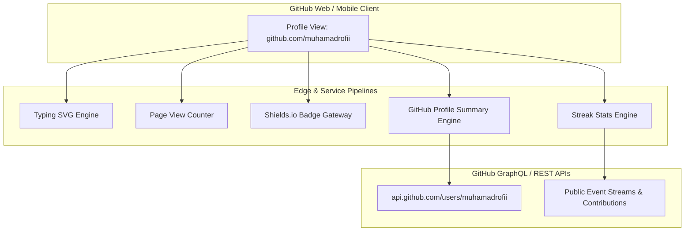

# Technical Specification: GitHub Profile Architecture

- **Project**: Developer Profile Landing Architecture
- **Repository**: `muhamadrofii/muhamadrofii`
- **Owner**: Muhamad Rofi'i (`muhamadrofii911@gmail.com`)
- **Role Positioning**: Software Engineer & Automation
- **Version**: 2.3.0
- **Status**: Production

---

## 1. System Objective & Scope

This specification defines the functional, structural, and integration requirements for the root GitHub Profile README (`muhamadrofii/muhamadrofii`). 

The architecture deploys an informative, high-signal developer portfolio adhering to the following engineering standards:
1. **Zero Tacky Emojis**: Replaced with verified Simple Icons and clean typographic hierarchy.
2. **Curated High-Signal Telemetry**: Focuses on verified annual activity curves and contribution consistency streaks, removing skewed language-by-repo donut charts.
3. **Structured Responsive Design**: Eliminates clunky markdown tables in favor of high-readability card blockquotes for projects and symmetrical metrics blocks.

---

## 2. Architecture & Telemetry Pipeline

---

## 3. Structural & Component Requirements

### 3.1 Hero Header & Identity
1. **Dynamic Vector Typewriter**:
   - Provider: `readme-typing-svg.demolab.com`
   - Parameters: `font=JetBrains+Mono&weight=500&size=20&pause=1500&color=38BDF8&center=true&vCenter=true&width=560`
   - Key Lines:
     - `Software Engineer & Automation`
     - `Full-Stack Web, Mobile & Data Pipelines`
     - `Nuxt 3 • Laravel • Django • Flutter`
     - `Headless Browser Automation & Scraping`
2. **Metadata & Status Badges**:
   - Page view counter (`komarev.com/ghpvc/`, `color=0284c7`, `style=flat-square`).
   - Specialization badge: `Focus-Software_Engineer_%26_Automation`.
3. **Verified Contact Gateways**:
   - Direct links with flat-square brand badges for Email, LinkedIn, and GitHub.

### 3.2 Technical Taxonomy (Shields.io + Simple Icons)

| Domain | Stack | Canonical Icon Key |
| :--- | :--- | :--- |
| **Languages** | JavaScript, TypeScript, Python, PHP, Dart, HTML5, CSS3, SQL | `javascript`, `typescript`, `python`, `php`, `dart`, `html5`, `css3`, `postgresql` |
| **Automation & Tools** | Playwright, Python Automation, Git, GitHub, Postman, Figma | `playwright`, `python`, `git`, `github`, `postman`, `figma` |
| **Backend & APIs** | Laravel, Django, Node.js, Express, Strapi | `laravel`, `django`, `nodedotjs`, `express`, `strapi` |
| **Frontend & Mobile** | Vue.js, Nuxt 3, Flutter, Tailwind CSS, Bootstrap | `vuedotjs`, `nuxtdotjs`, `flutter`, `tailwindcss`, `bootstrap` |
| **Storage & Databases** | MySQL, PostgreSQL, SQLite | `mysql`, `postgresql`, `sqlite` |

### 3.3 Cohesive Activity & Performance Telemetry

All metrics utilize the unified `tokyonight` theme to maintain visual symmetry:

| Service Component | Endpoint Pattern | Visual Dimensions & Output |
| :--- | :--- | :--- |
| **Annual Activity Wave** | `github-profile-summary-cards.../profile-details` | 700x200px overview card showing total annual contributions (315+), public repos (36), account age, and chronological contribution wave. |
| **Consistency Streak** | `streak-stats.demolab.com/?user=muhamadrofii` | 495x195px card tracking active streaks and total active contribution milestones. |

### 3.4 Selected Repository Index

Formatted using responsive markdown card blocks for optimal mobile/desktop rendering:
1. **Scraping & Automation Suite** (`Python`, `Playwright`) - `scraping-google-play`, `scraping-X-2025`
2. **Bank Sampah Digital Platform** (`Flutter`, `Node.js`, `Express`) - `banksampah-flutter`, `backendBankSampah`
3. **Smart City Mobile** (`Flutter`, `Dart`) - `smartcityflutteruas`
4. **Nuxt 3 Portfolio & CMS** (`Nuxt 3`, `Vue 3`, `Strapi`) - `nuxtJs-3-personalPortofolio`
5. **SIMKODES** (`Laravel`, `Blade`, `MySQL`) - `simkodes`

---

## 4. Performance & Reliability Runbook

1. **Service Decoupling**: Rather than relying on a single third-party Vercel instance, telemetry is balanced across dedicated services (`github-profile-summary-cards` and `streak-stats.demolab.com`).
2. **Fail-safe Caching**: Upstream HTTP cache TTLs (4 to 24 hours) ensure fast page loads and protect against GitHub secondary API rate limits.
