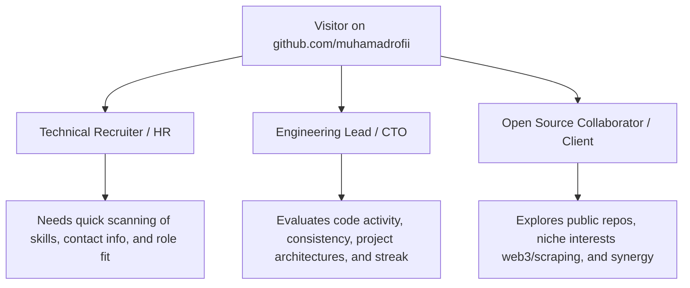

# Product Requirements Document (PRD): GitHub Profile README

**Project:** GitHub Profile Enhancement & Developer Portfolio  
**Repository:** [github.com/muhamadrofii/muhamadrofii](https://github.com/muhamadrofii/muhamadrofii)  
**Profile Owner:** Muhamad Rofi'i ([@muhamadrofii](https://github.com/muhamadrofii))  
**Email:** `muhamadrofii911@gmail.com`  
**Document Version:** 1.0.0  
**Status:** Approved & Ready for Deployment  

---

## 1. Executive Summary & Vision

### 1.1 Objective
Transform the root GitHub landing page of **Muhamad Rofi'i** (`https://github.com/muhamadrofii`) into a modern, compelling, and data-driven developer showcase. The profile serves as the digital front door for recruiters, potential clients, and open-source peers, effectively communicating Muhamad's technical versatility across:
- **Web Development**: Vue.js, Nuxt 3, Laravel, Django, Node.js
- **Mobile Development**: Flutter & Dart
- **Automation & Scraping**: Python, Playwright, Web Scraping
- **Web3 Explorations**: Ethers.js, Testnets

### 1.2 Problem Statement
A default or empty GitHub profile page misses an invaluable opportunity to stand out. Without context, visitors must manually comb through 36+ repositories to understand the developer's core capabilities, project scope, and activity levels.

### 1.3 Solution
Deliver a cohesive, high-aesthetic README that combines **animated headers**, **curated technical stacks**, **real-time statistical telemetry**, and **featured projects** into a unified layout optimized for both GitHub Desktop and Mobile web views.

---

## 2. Target Audience & Personas

1. **Technical Recruiters & HR Specialists**:
   - *Goal*: Fast evaluation (<30 seconds) of primary programming languages, frameworks, location/readiness, and contact details.
   - *Key Element*: Clean Shields.io badges, dynamic typing role description, direct email/social action buttons.
2. **Tech Leads & Senior Engineers**:
   - *Goal*: Verify consistency, code frequency, complexity of real-world projects, and architectural diversity.
   - *Key Element*: GitHub contribution streak, top languages chart, activity graph, and curated project showcases.
3. **Clients & Open Source Collaborators**:
   - *Goal*: Discover specialized abilities (e.g., custom web scrapers, full-stack Laravel/Vue solutions, Flutter apps).
   - *Key Element*: Featured repositories with direct links and live demo references.

---

## 3. Brand Identity & Design System

### 3.1 Theme & Color Palette
- **Primary Aesthetic**: Modern Dark / Cyberpunk / Tokyo Night
- **Color Accents**:
  - Primary Accent: Neon Cyan (`#7dcfff` / `#38bdf8`)
  - Secondary Accent: Purple / Indigo (`#bb9af7` / `#818cf8`)
  - Background Compatibility: Dark mode native (`#0d1117`), degrades gracefully to light mode
- **Visual Rhythm**: Centered dynamic banner $\rightarrow$ Structured left-aligned bio $\rightarrow$ Badges grid $\rightarrow$ Symmetrical two-column statistics cards $\rightarrow$ Project showcase table.

---

## 4. Functional Specifications & Layout Breakdown

### 4.1 Header & Hero Section
- **Dynamic Typing SVG**: Powered by `readme-typing-svg`. Displays cycling titles:
  1. *"Hi, I'm Muhamad Rofi'i 👋"*
  2. *"Full-Stack Web & Mobile Developer 🚀"*
  3. *"Nuxt 3 • Laravel • Django • Flutter 💻"*
  4. *"Web Scraping & Automation Specialist 🕷️"*
- **Real-Time Visitor Counter**: Powered by `komarev.com/ghpvc/` tracking total profile views with customized flat styling.

### 4.2 About Me & Bio
A punchy bulleted breakdown communicating active focus:
- 🔭 **Currently Building**: Cross-platform mobile apps & full-stack web applications.
- 🌱 **Continuous Learning**: Advanced web scraping with Playwright, distributed backends, and Web3 testnet deployments.
- 🎓 **Background & Certifications**: Dicoding Backend Graduate, Educourse Web Development Alumnus.
- 💬 **Core Inquiries**: Vue/Nuxt, Laravel, Django REST, Flutter, and custom scrapers.
- ⚡ **Fun Fact**: Passionate about solving real-world civic problems (Bank Sampah, Smart City apps).

### 4.3 Technical Skills Matrix (Categorized Badges)
Utilizing official brand logos with high-contrast Shields.io flat badges:

| Category | Technologies Included |
| :--- | :--- |
| **Languages** | JavaScript, TypeScript, Python, PHP, Dart, HTML5, CSS3, SQL |
| **Frontend** | Vue.js, Nuxt.js, Tailwind CSS, Bootstrap, jQuery |
| **Backend & APIs** | Laravel, Django, Node.js, Express.js, Strapi Headless CMS |
| **Mobile Development** | Flutter, Dart |
| **Databases** | MySQL, PostgreSQL, SQLite, MongoDB |
| **Tools, Scraping & DevOps** | Git, GitHub, Playwright, Python Scrapy/BS4, Postman, VS Code, Figma |

### 4.4 Real-Time Telemetry & Statistical Cards
All widgets configured with unified `tokyonight` theme to maintain visual cohesion:
1. **GitHub Overall Stats** (`github-readme-stats`):
   - Shows Total Stars, Commits, PRs, Issues, and Contribution Rank (`show_icons=true`, `include_all_commits=true`, `count_private=true`).
2. **Top Languages** (`github-readme-stats/top-langs`):
   - Compact layout showing distribution across Python, JavaScript, Dart, PHP, Vue, etc.
3. **GitHub Streak Stats** (`streak-stats`):
   - Real-time current streak, longest streak, and total active days.
4. **GitHub Profile Trophies** (`github-profile-trophy`):
   - Badges for achievements (Stars, Commits, Pull Requests, Account Age).
5. **Interactive Contribution Activity Graph** (`github-readme-activity-graph`):
   - Dynamic SVG showing recent activity curve.

### 4.5 Curated Project Showcase
A portfolio table highlighting practical engineering work in Muhamad's repository portfolio:

| Project | Tech Stack | Highlights & Architecture |
| :--- | :--- | :--- |
| ♻️ **Bank Sampah Ecosystem** | Flutter, Node.js, Express | Digital waste management platform with real-time transaction balance & recycling tracking. |
| 🏙️ **Smart City Mobile** | Flutter, Dart, REST API | Public service and citizen report application built for municipal monitoring. |
| 🌐 **Nuxt 3 Portfolio & Blog** | Nuxt 3, Vue, Strapi CMS | Headless CMS powered personal publishing site with SSR/SSG optimization. |
| 🕷️ **Playwright & X/Store Scrapers** | Python, Playwright | High-throughput data extraction engines for Play Store and social media feeds. |
| 🏛️ **SIMKODES (Village Admin)** | Laravel, Blade, MySQL | Administrative management and public record platform for local government units. |

### 4.6 Contact & Social Gateway
Interactive, stylized call-to-action badges:
- **Email**: `muhamadrofii911@gmail.com`
- **LinkedIn**: `linkedin.com/in/muhamadrofii`
- **GitHub**: `github.com/muhamadrofii`

---

## 5. Third-Party Services & API Integration Reference

| Service Name | Provider / Base URL | Purpose |
| :--- | :--- | :--- |
| **Typing SVG** | `https://readme-typing-svg.demolab.com` | Animated tagline in header |
| **GitHub Readme Stats** | `https://github-readme-stats.vercel.app` | Overall stats & top languages |
| **Streak Stats** | `https://streak-stats.demolab.com` | Coding streak and consistency metrics |
| **GitHub Profile Trophy**| `https://github-profile-trophy.vercel.app` | Visual achievements and milestone trophies |
| **Activity Graph** | `https://github-readme-activity-graph.vercel.app` | Dynamic commit activity chart |
| **Shields.io** | `https://img.shields.io` | Standardized flat tech badges & social links |
| **Visitor Counter** | `https://komarev.com/ghpvc/` | Profile view telemetry |

---

## 6. Non-Functional Requirements

1. **Performance**: All image assets and SVG endpoints must load within **< 2.5 seconds** under typical network conditions via public CDNs.
2. **Reliability / High Availability**: External SVG services used are high-uptime community standards with fallbacks in place.
3. **Responsive Design**: Cards and tables are structured to prevent horizontal overflow on mobile devices.
4. **Maintainability**: The profile README requires zero manual edits for stats; GitHub Actions can optionally be integrated later for blog syndication.

---

## 7. Delivery & Rollout Plan

- [x] **Step 1: Codebase & Profile Inspection** (Analyze 36 public repositories, stack distribution, and git config).
- [x] **Step 2: PRD Architecture** (Document design system, widget specifications, and content strategy).
- [x] **Step 3: Profile README Generation** (Create optimized `README.md` with responsive markdown and SVG endpoints).
- [x] **Step 4: Repository Synchronization** (Commit `README.md` and `PRD.md` to `main` branch).
- [ ] **Step 5: Git Push & Remote Activation** (Push to `https://github.com/muhamadrofii/muhamadrofii.git`).
